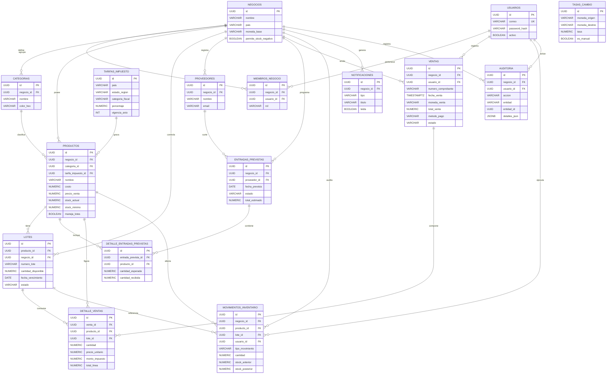

# Base de datos — StockPro

**Motor:** PostgreSQL 16
**Esquema:** 16 tablas de negocio + `flyway_schema_history`
**Migraciones:** `V1__initial_schema.sql`, `V2__tax_rates_and_exchange_rates.sql`, `V3__seed_demo_data.sql`
**Ubicación:** `backend/src/main/resources/db/migration/` (ejecutadas por Spring Boot) y `database/migrations/` (copia de referencia)
**Fecha de cierre:** 16/11/2026

---

## 1. Principios del modelo

1. **Multi-negocio.** Casi todas las tablas de operación llevan `negocio_id`. El aislamiento se refuerza en el backend: el id sale del JWT, no del cuerpo de la petición.
2. **UUID como llave.** Facilita la generación distribuida y evita ids predecibles. PostgreSQL usa `gen_random_uuid()` con la extensión `pgcrypto`.
3. **Dinero con `NUMERIC`.** Nunca `FLOAT`: los importes usan `NUMERIC(14,2)` y las tasas `NUMERIC(16,6)`.
4. **Tiempo con zona.** `TIMESTAMPTZ` para eventos; `DATE` para vencimientos y fechas previstas.
5. **Integridad declarativa.** Estados, monedas, roles y tipos se restringen con `CHECK`; los duplicados, con `UNIQUE`; las relaciones, con llaves foráneas.
6. **Histórico inmutable.** Una venta congela su moneda, tasa, precio, costo, tarifa y monto de impuesto. Cambiar una tasa no reescribe el pasado.
7. **Borrado lógico.** Productos y categorías se desactivan (`activo = false`); no se eliminan si tienen historial.
8. **Trazabilidad.** Movimientos de inventario y auditoría registran usuario, motivo y referencia.

## 2. Diagrama entidad-relación



## 3. Diccionario de datos

### 3.1 `negocios`

| Columna | Tipo | Nulo | Llave / restricción | Descripción |
|---|---|---|---|---|
| `id` | UUID | No | PK, `gen_random_uuid()` | Identificador del negocio. |
| `nombre` | VARCHAR(150) | No | | Nombre comercial. |
| `tipo_negocio` | VARCHAR(50) | No | | Tienda, minimercado, panadería, bottega, etc. |
| `identificacion_fiscal` | VARCHAR(50) | Sí | | NIT, RUT, VAT o equivalente. |
| `pais` | VARCHAR(2) | No | | Código ISO-3166 alpha-2 (`CO`, `US`, `IT`…). |
| `estado_region` | VARCHAR(100) | Sí | | Estado o región; solo aplica a EE. UU. |
| `moneda_base` | VARCHAR(3) | No | `CHECK IN (COP, USD, EUR)` | Moneda de operación. |
| `zona_horaria` | VARCHAR(50) | No | Default `America/Bogota` | Zona para reportes y fechas. |
| `permite_stock_negativo` | BOOLEAN | No | Default `FALSE` | Excepción explícita a RN-01. |
| `activo` | BOOLEAN | No | Default `TRUE` | Borrado lógico del negocio. |
| `created_at`, `updated_at` | TIMESTAMPTZ | No | Default `CURRENT_TIMESTAMP` | Auditoría temporal. |

### 3.2 `usuarios`

| Columna | Tipo | Nulo | Llave / restricción | Descripción |
|---|---|---|---|---|
| `id` | UUID | No | PK | Identificador. |
| `nombre` | VARCHAR(150) | No | | Nombre completo. |
| `correo` | VARCHAR(150) | No | UNIQUE | Credencial de acceso. |
| `password_hash` | VARCHAR(255) | No | | Hash BCrypt; nunca texto plano. |
| `telefono` | VARCHAR(50) | Sí | | Contacto. |
| `activo` | BOOLEAN | No | Default `TRUE` | Permite suspender el acceso. |
| `created_at`, `updated_at` | TIMESTAMPTZ | No | Default `CURRENT_TIMESTAMP` | Auditoría temporal. |

### 3.3 `miembros_negocio`

| Columna | Tipo | Nulo | Llave / restricción | Descripción |
|---|---|---|---|---|
| `id` | UUID | No | PK | Identificador de la membresía. |
| `negocio_id` | UUID | No | FK → `negocios(id)` `CASCADE` | Negocio al que pertenece. |
| `usuario_id` | UUID | No | FK → `usuarios(id)` `CASCADE` | Usuario miembro. |
| `rol` | VARCHAR(30) | No | `CHECK IN (PROPIETARIO, ADMINISTRADOR, EMPLEADO, CONSULTA)` | Autorización. |
| `permisos` | JSONB | No | Default `[]` | Reservado para permisos granulares. |
| `created_at` | TIMESTAMPTZ | No | Default `CURRENT_TIMESTAMP` | Fecha de vinculación. |
| — | — | — | UNIQUE (`negocio_id`, `usuario_id`) | Un usuario no se duplica en el mismo negocio. |

### 3.4 `categorias`

| Columna | Tipo | Nulo | Llave / restricción | Descripción |
|---|---|---|---|---|
| `id` | UUID | No | PK | Identificador. |
| `negocio_id` | UUID | No | FK → `negocios(id)` `CASCADE` | Dueño de la categoría. |
| `nombre` | VARCHAR(100) | No | UNIQUE (`negocio_id`, `nombre`) | Nombre visible. |
| `descripcion` | VARCHAR(255) | Sí | | Detalle opcional. |
| `color_hex` | VARCHAR(10) | Sí | Default `#087F5B` | Color de la categoría en la UI. |
| `activo` | BOOLEAN | No | Default `TRUE` | Borrado lógico. |
| `created_at` | TIMESTAMPTZ | No | Default `CURRENT_TIMESTAMP` | Creación. |

### 3.5 `tarifas_impuesto`

| Columna | Tipo | Nulo | Llave / restricción | Descripción |
|---|---|---|---|---|
| `id` | UUID | No | PK | Identificador. |
| `pais` | VARCHAR(2) | No | | País de la tarifa. |
| `estado_region` | VARCHAR(50) | Sí | | Estado de EE. UU.; nulo en los demás. |
| `categoria_fiscal` | VARCHAR(50) | No | | GENERAL, DIFERENCIAL, EXENTO, EXCLUIDO, ALIMENTOS_BASICOS, ORDINARIA, RIDOTTA_10, etc. |
| `tipo_impuesto` | VARCHAR(30) | No | `CHECK IN (IVA, CONSUMO, SALES_TAX)` | Naturaleza del impuesto. |
| `porcentaje` | NUMERIC(5,2) | No | `CHECK >= 0` | Tarifa aplicable. |
| `vigencia_anio` | INT | No | Default `2026` | Año fiscal. |
| `fuente` | VARCHAR(255) | No | | Norma o agencia que respalda la tarifa. |
| `descripcion` | VARCHAR(255) | No | | Explicación del bien o servicio. |
| `activo` | BOOLEAN | No | Default `TRUE` | Permite retirar una tarifa sin borrar el histórico. |
| `created_at` | TIMESTAMPTZ | No | Default `CURRENT_TIMESTAMP` | Creación. |

### 3.6 `tasas_cambio`

| Columna | Tipo | Nulo | Llave / restricción | Descripción |
|---|---|---|---|---|
| `id` | UUID | No | PK | Identificador. |
| `moneda_origen` | VARCHAR(3) | No | `CHECK IN (COP, USD, EUR)` | Moneda de origen. |
| `moneda_destino` | VARCHAR(3) | No | `CHECK IN (COP, USD, EUR)` | Moneda de destino. |
| `tasa` | NUMERIC(16,6) | No | `CHECK > 0` | Factor de conversión. |
| `fecha_actualizacion` | TIMESTAMPTZ | No | Default `CURRENT_TIMESTAMP` | Última actualización. |
| `fuente` | VARCHAR(100) | No | Default `ExchangeRate-API` | Origen del dato. |
| `es_manual` | BOOLEAN | No | Default `FALSE` | Distingue carga manual de API. |
| — | — | — | UNIQUE (`moneda_origen`, `moneda_destino`) | Un solo par por monedas. |

### 3.7 `productos`

| Columna | Tipo | Nulo | Llave / restricción | Descripción |
|---|---|---|---|---|
| `id` | UUID | No | PK | Identificador. |
| `negocio_id` | UUID | No | FK → `negocios(id)` `CASCADE` | Dueño. |
| `categoria_id` | UUID | No | FK → `categorias(id)` `RESTRICT` | Clasificación; no se borra si tiene productos. |
| `nombre` | VARCHAR(150) | No | UNIQUE (`negocio_id`, `nombre`) | Nombre visible. |
| `codigo_barras` | VARCHAR(50) | Sí | | EAN/UPC opcional. |
| `unidad_medida` | VARCHAR(20) | No | Default `UNIDAD` | UNIDAD, KG, L, etc. |
| `costo` | NUMERIC(14,2) | No | `CHECK >= 0` | Costo de compra. |
| `precio_venta` | NUMERIC(14,2) | No | `CHECK >= 0` | Precio oficial de venta. |
| `categoria_fiscal` | VARCHAR(50) | No | | Categoría usada para resolver la tarifa. |
| `tarifa_impuesto_id` | UUID | Sí | FK → `tarifas_impuesto(id)` | Tarifa asociada. |
| `porcentaje_impuesto_aplicado` | NUMERIC(5,2) | No | Default `0.00` | Tarifa vigente al crear/editar. |
| `precio_incluye_impuesto` | BOOLEAN | No | Default `TRUE` | Si el precio mostrado ya incluye impuesto. |
| `stock_actual` | NUMERIC(12,2) | No | Default `0.00` | Existencias consolidadas. |
| `stock_minimo` | NUMERIC(12,2) | No | Default `5.00` | Umbral de alerta. |
| `maneja_lotes` | BOOLEAN | No | Default `FALSE` | Activa FEFO y vencimientos. |
| `imagen_url` | TEXT | Sí | Agregada por JPA (`ddl-auto=update`) | Ruta local o URL de la imagen. No está en V1. |
| `activo` | BOOLEAN | No | Default `TRUE` | Borrado lógico. |
| `created_at`, `updated_at` | TIMESTAMPTZ | No | Default `CURRENT_TIMESTAMP` | Auditoría temporal. |

### 3.8 `lotes`

| Columna | Tipo | Nulo | Llave / restricción | Descripción |
|---|---|---|---|---|
| `id` | UUID | No | PK | Identificador. |
| `producto_id` | UUID | No | FK → `productos(id)` `CASCADE` | Producto del lote. |
| `negocio_id` | UUID | No | FK → `negocios(id)` `CASCADE` | Negocio. |
| `numero_lote` | VARCHAR(50) | No | UNIQUE (`producto_id`, `numero_lote`) | Identificación del proveedor. |
| `cantidad_inicial` | NUMERIC(12,2) | No | `CHECK > 0` | Unidades recibidas. |
| `cantidad_disponible` | NUMERIC(12,2) | No | `CHECK >= 0` | Unidades restantes. |
| `fecha_ingreso` | DATE | No | Default `CURRENT_DATE` | Entrada al inventario. |
| `fecha_vencimiento` | DATE | Sí | | Fecha clave para FEFO y alertas. |
| `estado` | VARCHAR(20) | No | `CHECK IN (ACTIVO, AGOTADO, VENCIDO, DADO_DE_BAJA)` | Ciclo de vida. |
| `created_at` | TIMESTAMPTZ | No | Default `CURRENT_TIMESTAMP` | Creación. |

### 3.9 `proveedores`

| Columna | Tipo | Nulo | Llave / restricción | Descripción |
|---|---|---|---|---|
| `id` | UUID | No | PK | Identificador. |
| `negocio_id` | UUID | No | FK → `negocios(id)` `CASCADE` | Dueño. |
| `nombre` | VARCHAR(150) | No | | Razón social o nombre. |
| `contacto` | VARCHAR(100) | Sí | | Persona de contacto. |
| `telefono` | VARCHAR(50) | Sí | | Teléfono. |
| `email` | VARCHAR(100) | Sí | | Correo. |
| `direccion` | VARCHAR(200) | Sí | | Dirección. |
| `activo` | BOOLEAN | No | Default `TRUE` | Borrado lógico. |
| `created_at` | TIMESTAMPTZ | No | Default `CURRENT_TIMESTAMP` | Creación. |

### 3.10 `entradas_previstas`

| Columna | Tipo | Nulo | Llave / restricción | Descripción |
|---|---|---|---|---|
| `id` | UUID | No | PK | Identificador. |
| `negocio_id` | UUID | No | FK → `negocios(id)` `CASCADE` | Dueño. |
| `proveedor_id` | UUID | Sí | FK → `proveedores(id)` `SET NULL` | Proveedor; si se borra, la entrada queda sin proveedor. |
| `numero_orden` | VARCHAR(50) | Sí | | Referencia de la orden. |
| `fecha_prevista` | DATE | No | | Día de entrega. |
| `estado` | VARCHAR(20) | No | `CHECK IN (PENDIENTE, RECIBIDA, PARCIAL, CANCELADA)` | Seguimiento. |
| `total_estimado` | NUMERIC(14,2) | No | Default `0.00` | Valor estimado. |
| `notas` | TEXT | Sí | | Observaciones. |
| `fecha_recibida` | TIMESTAMPTZ | Sí | | Momento de la recepción. |
| `created_at` | TIMESTAMPTZ | No | Default `CURRENT_TIMESTAMP` | Creación. |

### 3.11 `detalle_entradas_previstas`

| Columna | Tipo | Nulo | Llave / restricción | Descripción |
|---|---|---|---|---|
| `id` | UUID | No | PK | Identificador. |
| `entrada_prevista_id` | UUID | No | FK → `entradas_previstas(id)` `CASCADE` | Entrada padre. |
| `producto_id` | UUID | No | FK → `productos(id)` `RESTRICT` | Producto esperado. |
| `cantidad_esperada` | NUMERIC(12,2) | No | `CHECK > 0` | Unidades pedidas. |
| `cantidad_recibida` | NUMERIC(12,2) | No | Default `0.00` | Unidades confirmadas. |
| `costo_unitario` | NUMERIC(14,2) | No | Default `0.00` | Costo de la orden. |

### 3.12 `ventas`

| Columna | Tipo | Nulo | Llave / restricción | Descripción |
|---|---|---|---|---|
| `id` | UUID | No | PK | Identificador. |
| `negocio_id` | UUID | No | FK → `negocios(id)` `CASCADE` | Dueño. |
| `usuario_id` | UUID | Sí | FK → `usuarios(id)` `SET NULL` | Cajero; si se borra, la venta se conserva. |
| `numero_comprobante` | VARCHAR(50) | No | | Número legible del comprobante. |
| `fecha_venta` | TIMESTAMPTZ | No | Default `CURRENT_TIMESTAMP` | Fecha y hora. |
| `moneda_venta` | VARCHAR(3) | No | `CHECK IN (COP, USD, EUR)` | Moneda congelada. |
| `tasa_cambio_base` | NUMERIC(16,6) | No | Default `1.000000` | Tasa usada al registrar. |
| `subtotal_base` | NUMERIC(14,2) | No | Default `0.00` | Subtotal antes de impuestos y descuentos. |
| `total_impuestos` | NUMERIC(14,2) | No | Default `0.00` | Impuestos sumados. |
| `total_descuentos` | NUMERIC(14,2) | No | Default `0.00` | Descuentos aplicados. |
| `total_venta` | NUMERIC(14,2) | No | Default `0.00` | Total cobrado. |
| `metodo_pago` | VARCHAR(30) | No | `CHECK IN (EFECTIVO, TARJETA, TRANSFERENCIA, MIXTO, OTRO)` | Forma de pago. |
| `estado` | VARCHAR(20) | No | `CHECK IN (COMPLETADA, ANULADA)` | Estado de la venta. |
| `notas` | TEXT | Sí | | Autorización de descuento u observaciones. |
| `created_at` | TIMESTAMPTZ | No | Default `CURRENT_TIMESTAMP` | Creación. |

### 3.13 `detalle_ventas`

| Columna | Tipo | Nulo | Llave / restricción | Descripción |
|---|---|---|---|---|
| `id` | UUID | No | PK | Identificador. |
| `venta_id` | UUID | No | FK → `ventas(id)` `CASCADE` | Venta padre. |
| `producto_id` | UUID | No | FK → `productos(id)` `RESTRICT` | Producto vendido. |
| `lote_id` | UUID | Sí | FK → `lotes(id)` `SET NULL` | Lote consumido por FEFO. |
| `cantidad` | NUMERIC(12,2) | No | `CHECK > 0` | Unidades. |
| `precio_unitario` | NUMERIC(14,2) | No | `CHECK >= 0` | Precio oficial congelado. |
| `costo_unitario` | NUMERIC(14,2) | No | `CHECK >= 0` | Costo congelado para margen. |
| `subtotal_bruto` | NUMERIC(14,2) | No | | Cantidad × precio. |
| `descuento` | NUMERIC(14,2) | No | Default `0.00` | Descuento de la línea. |
| `categoria_fiscal` | VARCHAR(50) | No | | Categoría usada. |
| `tarifa_impuesto_porcentaje` | NUMERIC(5,2) | No | | Tarifa congelada. |
| `monto_impuesto` | NUMERIC(14,2) | No | Default `0.00` | Impuesto de la línea. |
| `total_linea` | NUMERIC(14,2) | No | | Subtotal − descuento + impuesto. |

### 3.14 `movimientos_inventario`

| Columna | Tipo | Nulo | Llave / restricción | Descripción |
|---|---|---|---|---|
| `id` | UUID | No | PK | Identificador. |
| `negocio_id` | UUID | No | FK → `negocios(id)` `CASCADE` | Dueño. |
| `producto_id` | UUID | No | FK → `productos(id)` `RESTRICT` | Producto afectado. |
| `lote_id` | UUID | Sí | FK → `lotes(id)` `SET NULL` | Lote afectado, si aplica. |
| `tipo_movimiento` | VARCHAR(30) | No | `CHECK IN (VENTA, ENTRADA, PERDIDA, DANADO, AJUSTE_POSITIVO, AJUSTE_NEGATIVO, DEVOLUCION)` | Naturaleza. |
| `cantidad` | NUMERIC(12,2) | No | | Unidades del movimiento. |
| `stock_anterior` | NUMERIC(12,2) | No | | Foto antes del cambio. |
| `stock_posterior` | NUMERIC(12,2) | No | | Foto después del cambio. |
| `costo_referencia` | NUMERIC(14,2) | No | Default `0.00` | Costo para valorar pérdidas. |
| `motivo` | TEXT | No | | Justificación obligatoria. |
| `usuario_id` | UUID | Sí | FK → `usuarios(id)` `SET NULL` | Quién ejecutó. |
| `referencia_tipo` | VARCHAR(50) | Sí | | VENTA, LOTE, ENTRADA, AJUSTE… |
| `referencia_id` | UUID | Sí | | Id del documento origen. |
| `fecha_movimiento` | TIMESTAMPTZ | No | Default `CURRENT_TIMESTAMP` | Fecha del hecho. |
| `created_at` | TIMESTAMPTZ | No | Default `CURRENT_TIMESTAMP` | Persistencia. |

### 3.15 `notificaciones`

| Columna | Tipo | Nulo | Llave / restricción | Descripción |
|---|---|---|---|---|
| `id` | UUID | No | PK | Identificador. |
| `negocio_id` | UUID | No | FK → `negocios(id)` `CASCADE` | Destinatario. |
| `tipo` | VARCHAR(30) | No | `CHECK IN (STOCK_BAJO, PROXIMO_VENCER, VENCIDO, ENTRADA_PREVISTA, SISTEMA)` | Categoría. |
| `referencia_id` | UUID | Sí | | Producto, lote, venta o entrada. |
| `titulo` | VARCHAR(150) | No | | Texto corto. |
| `mensaje` | TEXT | No | | Detalle. |
| `leida` | BOOLEAN | No | Default `FALSE` | Estado de lectura. |
| `created_at` | TIMESTAMPTZ | No | Default `CURRENT_TIMESTAMP` | Creación. |

> La entidad JPA `Notificacion` agrega `prioridad` y `referencia_tipo` con `ddl-auto=update`; V1 no las declara. Se documentan como extensión del modelo.

### 3.16 `auditoria`

| Columna | Tipo | Nulo | Llave / restricción | Descripción |
|---|---|---|---|---|
| `id` | UUID | No | PK | Identificador. |
| `negocio_id` | UUID | Sí | FK → `negocios(id)` `CASCADE` | Negocio del evento. |
| `usuario_id` | UUID | Sí | FK → `usuarios(id)` `SET NULL` | Usuario que actuó. |
| `accion` | VARCHAR(50) | No | | CREATE, UPDATE, DELETE, LOGIN, SALE… |
| `entidad` | VARCHAR(50) | No | | Tabla o recurso afectado. |
| `entidad_id` | UUID | Sí | | Id del registro. |
| `detalles_json` | JSONB | Sí | | Cambio o contexto. |
| `ip_origen` | VARCHAR(45) | Sí | | IPv4/IPv6. |
| `created_at` | TIMESTAMPTZ | No | Default `CURRENT_TIMESTAMP` | Fecha del evento. |

### 3.17 `flyway_schema_history`

Tabla de control creada por Flyway. Registra versión, descripción, tipo, script, checksum, usuario, fecha y tiempo de ejecución. No se modifica manualmente. Es la evidencia de que V1, V2 y V3 se aplicaron en orden.

## 4. Relaciones y cardinalidad

| Relación | Cardinalidad | Regla |
|---|---|---|
| Negocio–Usuario | N:M vía `miembros_negocio` | Un usuario puede pertenecer a varios negocios; un negocio tiene varios miembros. |
| Negocio–Producto | 1:N | Un producto pertenece a un solo negocio. |
| Categoría–Producto | 1:N | Una categoría agrupa varios productos; no se elimina si tiene productos. |
| Producto–Lote | 1:N | Un producto puede tener varios lotes; cada lote pertenece a un producto. |
| Proveedor–Entrada prevista | 1:N | Un proveedor surte varias entradas; una entrada puede quedar sin proveedor. |
| Entrada–Detalle | 1:N | Una entrada tiene varios productos. |
| Venta–Detalle | 1:N | Una venta tiene varias líneas. |
| Producto–Detalle de venta | 1:N | Un producto aparece en muchas ventas históricas. |
| Lote–Detalle de venta | 1:N | Un lote puede abastecer varias líneas; la línea conserva el lote usado. |
| Producto–Movimiento | 1:N | Cada cambio de stock genera un movimiento. |
| Negocio–Notificación | 1:N | Las alertas se agrupan por negocio. |

## 5. Índices

| Índice | Tabla | Uso |
|---|---|---|
| `idx_miembros_usuario` | `miembros_negocio(usuario_id)` | Resolver los negocios de un usuario al iniciar sesión. |
| `idx_categorias_negocio` | `categorias(negocio_id)` | Listar categorías del negocio. |
| `idx_productos_negocio` | `productos(negocio_id)` | Catálogo aislado por negocio. |
| `idx_productos_categoria` | `productos(categoria_id)` | Filtro por categoría. |
| `idx_lotes_producto_vencimiento` | `lotes(producto_id, fecha_vencimiento)` | FEFO y alertas de vencimiento. |
| `idx_lotes_negocio_estado` | `lotes(negocio_id, estado)` | Lotes activos, agotados o vencidos. |
| `idx_entradas_previstas_negocio_fecha` | `entradas_previstas(negocio_id, fecha_prevista)` | Entradas de hoy y mañana. |
| `idx_ventas_negocio_fecha` | `ventas(negocio_id, fecha_venta)` | Historial y reportes por periodo. |
| `idx_detalle_ventas_venta` | `detalle_ventas(venta_id)` | Detalle de una venta. |
| `idx_detalle_ventas_producto` | `detalle_ventas(producto_id)` | Productos más y menos vendidos. |
| `idx_movimientos_negocio_fecha` | `movimientos_inventario(negocio_id, fecha_movimiento)` | Historial de movimientos. |
| `idx_movimientos_producto` | `movimientos_inventario(producto_id)` | Trazabilidad por producto. |
| `idx_notificaciones_negocio_leida` | `notificaciones(negocio_id, leida)` | Alertas pendientes. |
| `idx_auditoria_negocio_fecha` | `auditoria(negocio_id, created_at)` | Revisión de auditoría. |

## 6. Integridad transaccional (ACID)

La operación crítica es la venta. `VentaService.createSale()` se ejecuta dentro de una transacción Spring (`@Transactional`) sobre una sola base PostgreSQL. El orden es:

1. **Valida** que el negocio exista y que el usuario tenga permiso para descontar.
2. **Lee** los productos y verifica que estén activos y con stock suficiente.
3. **Resuelve** la tarifa de impuesto por país, estado y categoría fiscal.
4. **Selecciona** los lotes FEFO (vencimiento más próximo, estado `ACTIVO`).
5. **Calcula** subtotal, descuento, impuesto, total de línea y totales de la venta.
6. **Escribe** `ventas` y `detalle_ventas`.
7. **Actualiza** `productos.stock_actual` y `lotes.cantidad_disponible`; marca `AGOTADO` cuando llega a cero.
8. **Inserta** un `movimientos_inventario` por cada línea con stock anterior y posterior.
9. **Confirma** la transacción.

Si cualquier paso lanza una excepción de negocio, Spring revierte todo: no queda una venta a medias ni un stock descontado sin comprobante.

| Propiedad ACID | Cómo se cumple |
|---|---|
| **Atomicidad** | `@Transactional` en la venta y en la recepción de entradas; rollback ante `STOCK_INSUFICIENTE`, `PRODUCTO_INACTIVO` o error de validación. |
| **Consistencia** | `CHECK`, `UNIQUE`, llaves foráneas y validaciones de servicio. El stock no baja de cero salvo configuración expresa. |
| **Aislamiento** | PostgreSQL en nivel `READ COMMITTED` por defecto; las escrituras de una venta no son visibles hasta el commit. |
| **Durabilidad** | WAL de PostgreSQL; una vez confirmado el commit, la venta sobrevive a un reinicio. |

### 6.1 Otras operaciones transaccionales

| Operación | Servicio | Efecto atómico |
|---|---|---|
| Crear lote | `LoteService.createLote()` | Inserta lote, suma stock y registra `ENTRADA`. |
| Baja de lote | `LoteService.bajaLote()` | Descuenta disponible, marca `DADO_DE_BAJA` y registra `PERDIDA`. |
| Movimiento manual | `MovimientoInventarioService` | Actualiza stock y registra el movimiento con stock anterior/posterior. |
| Crear entrada prevista | `EntradaPrevistaService` | Inserta cabecera y detalle; **no** toca stock. |
| Recibir entrada | `EntradaPrevistaService.receive()` | Crea lote si aplica, suma stock, registra `ENTRADA`, marca `RECIBIDA` o `PARCIAL`. |
| Venta | `VentaService.createSale()` | Venta + líneas + stock + lotes + movimientos. |

## 7. Migraciones Flyway

| Versión | Script | Contenido | Idempotencia |
|---|---|---|---|
| V1 | `V1__initial_schema.sql` | Extensión `pgcrypto`, 16 tablas, restricciones e índices. | `CREATE TABLE IF NOT EXISTS`, `CREATE INDEX IF NOT EXISTS`. |
| V2 | `V2__tax_rates_and_exchange_rates.sql` | 24 tarifas 2026 (CO, US, IT, DE, ES, FR, PT, BG) y 9 pares de tasas. | `INSERT` simple; se ejecuta una sola vez por Flyway. |
| V3 | `V3__seed_demo_data.sql` | 3 negocios, usuarios, membresías, categorías, proveedores, 48 productos, lotes, ventas, movimientos y notificaciones con fechas relativas a `CURRENT_DATE`. | `INSERT` con UUID fijos; requiere base limpia o volumen recreado. |

**Regla del proyecto:** una migración aplicada no se edita. Cualquier cambio de esquema se agrega como `V4__...sql`. Para reiniciar el entorno de desarrollo:

```bash
docker compose down -v
docker compose up -d
```

## 8. Datos semilla

| Negocio | País | Moneda | Productos | Tarifas usadas | Casos de prueba |
|---|---|---|---|---|---|
| Mi Tienda | Colombia | COP | 18 | IVA 19 %, diferencial 5 %, excluido 0 %, consumo 8 % | Stock bajo, lote vencido hace 3 días, lote por vencer en 4 días, entrada prevista |
| Corner Market | Estados Unidos (CA) | USD | 15 | Sales Tax 7.25 %, alimentos 0 % | Lote vencido hace 2 días, lote por vencer en 5 días |
| Bottega Roma | Italia | EUR | 15 | IVA 4 %, 10 %, 22 % | Stock bajo, lote vencido hace 1 día, lote por vencer en 3 días, lote vigente |

Usuarios demo (contraseña `Password123*`): `carlos@mitienda.com`, `robert@cornermarket.com`, `matteo@bottegaroma.it`.

## 9. Consultas representativas

```sql
-- Productos bajo el mínimo de un negocio
SELECT nombre, stock_actual, stock_minimo
FROM productos
WHERE negocio_id = :negocioId
  AND activo = TRUE
  AND stock_actual <= stock_minimo
ORDER BY (stock_minimo - stock_actual) DESC;

-- Lotes que vencen en los próximos 7 días
SELECT p.nombre, l.numero_lote, l.fecha_vencimiento, l.cantidad_disponible
FROM lotes l
JOIN productos p ON p.id = l.producto_id
WHERE l.negocio_id = :negocioId
  AND l.estado = 'ACTIVO'
  AND l.fecha_vencimiento BETWEEN CURRENT_DATE AND CURRENT_DATE + INTERVAL '7 days'
ORDER BY l.fecha_vencimiento;

-- Ventas y ganancia bruta del periodo
SELECT COUNT(*) AS ventas,
       SUM(v.total_venta) AS ingresos,
       SUM(dv.costo_unitario * dv.cantidad) AS costo,
       SUM(v.total_venta) - SUM(dv.costo_unitario * dv.cantidad) AS ganancia
FROM ventas v
JOIN detalle_ventas dv ON dv.venta_id = v.id
WHERE v.negocio_id = :negocioId
  AND v.estado = 'COMPLETADA'
  AND v.fecha_venta >= :inicio
  AND v.fecha_venta < :fin;

-- Productos más vendidos del periodo
SELECT p.nombre, SUM(dv.cantidad) AS unidades
FROM detalle_ventas dv
JOIN ventas v ON v.id = dv.venta_id
JOIN productos p ON p.id = dv.producto_id
WHERE v.negocio_id = :negocioId
  AND v.fecha_venta >= :inicio
GROUP BY p.nombre
ORDER BY unidades DESC
LIMIT 5;
```

## 10. Respaldos y mantenimiento

- **Respaldo lógico:** `pg_dump -U stockpro_user -d stockpro_db -F c -f stockpro_backup.dump`.
- **Restauración:** `pg_restore -U stockpro_user -d stockpro_db --clean stockpro_backup.dump`.
- **Respaldo del volumen Docker:** detener el contenedor y copiar el volumen `postgres_data`.
- **Revisión anual:** actualizar `tarifas_impuesto` con la vigencia siguiente mediante una nueva migración; nunca borrar el histórico.
- **Crecimiento:** `ventas`, `detalle_ventas` y `movimientos_inventario` son las tablas que más crecen; los índices por negocio y fecha sostienen los reportes.

## 11. Limitaciones declaradas

1. El Sales Tax se modela a nivel estatal; no incluye impuestos de condado o ciudad.
2. No hay particionamiento ni réplica; el volumen académico no lo requiere.
3. `imagen_url`, `prioridad` y `referencia_tipo` se agregan por JPA y no están en V1; para producción se recomienda consolidarlos en una migración V4.
4. La tabla `auditoria` existe y está modelada, pero no todas las operaciones del servicio escriben en ella; los movimientos de inventario sí cubren la trazabilidad crítica.
