# Diagramas UML y Scrum — StockPro

**Proyecto:** StockPro · **Autora:** Sairy Ximena Mosquera García
**Curso:** Diseño de Aplicaciones Móviles — Taller ABP
**Fecha:** 16/11/2026

Todos los diagramas están escritos en **Mermaid** y se renderizan en GitHub, en la landing page y en la presentación HTML. Se basan en el código real: 17 pantallas, 13 ViewModels, 12 controladores, 10 servicios y 37 endpoints.

---

## 1. Arquitectura y despliegue

Vista física y lógica: el teléfono ejecuta la app Android; la API corre en Spring Boot; PostgreSQL persiste; Flyway prepara el esquema. En desarrollo todo vive en el mismo equipo; en producción la API y la base se desplazan a un servidor y el tráfico va por HTTPS.

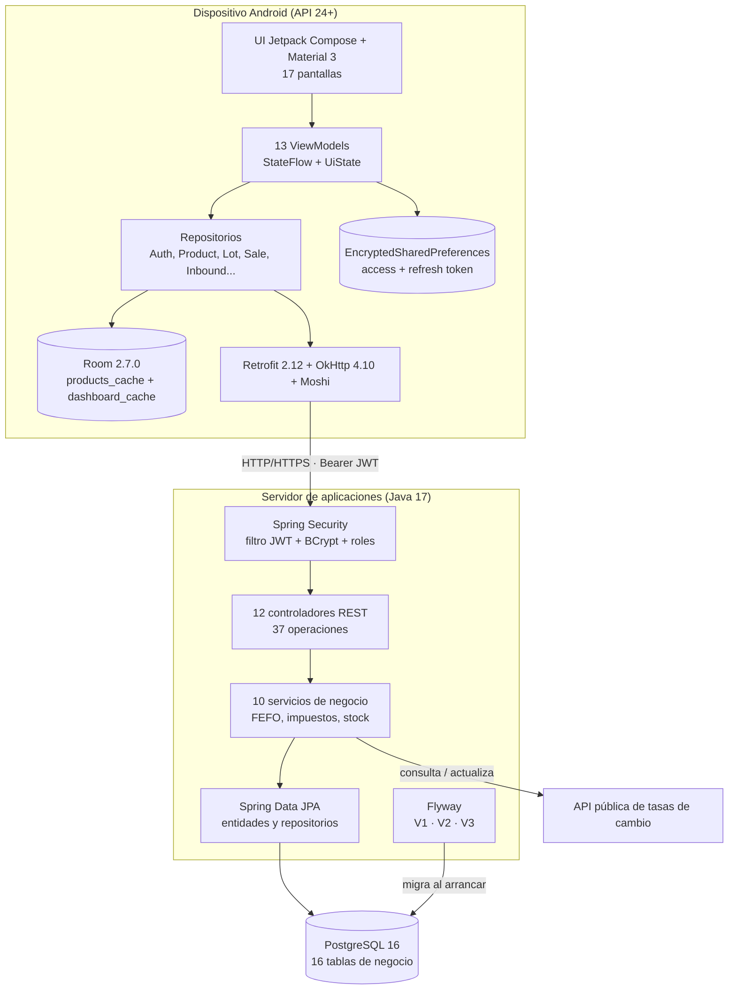

**Lectura del diagrama**

- La app nunca escribe stock directamente: toda operación pasa por la API.
- Room es caché de lectura; EncryptedSharedPreferences guarda los tokens.
- El backend concentra las reglas de negocio y el aislamiento por negocio.
- Flyway se ejecuta al arrancar Spring Boot y deja la base reproducible.
- La API externa de tasas es opcional: si falla, se conserva la última tasa o se carga manualmente.

## 2. Diagrama de componentes

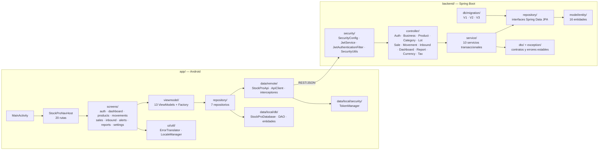

**Regla de dependencia:** las pantallas dependen de ViewModels; los ViewModels de repositorios; los repositorios de Retrofit y Room. En el backend, controladores → servicios → repositorios → entidades. Ninguna capa salta a la siguiente.

## 3. Diagrama de casos de uso

Los actores reales son los cuatro roles del sistema. El actor **Sistema** representa las reglas automáticas (stock, FEFO, impuestos, alertas).

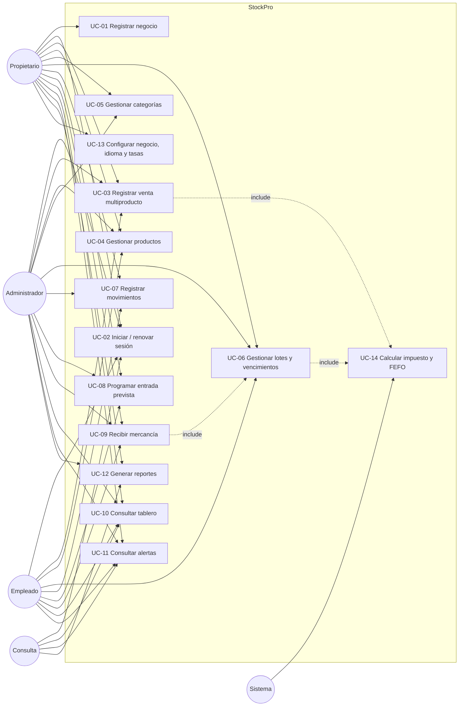

**Restricciones de rol**

| Caso de uso | Propietario | Administrador | Empleado | Consulta |
|---|---|---|---|---|
| Registrar negocio | Sí | — | — | — |
| Venta con descuento | Sí | Sí | No | No |
| Configurar negocio y tasas | Sí | Sí | No | No |
| Productos, lotes, movimientos, entradas | Sí | Sí | Sí | No |
| Tablero, alertas y reportes | Sí | Sí | Sí | Sí |

## 4. Diagrama de clases del dominio

Se muestran las entidades principales y sus atributos clave. Los detalles completos están en `04-base-de-datos.md`.

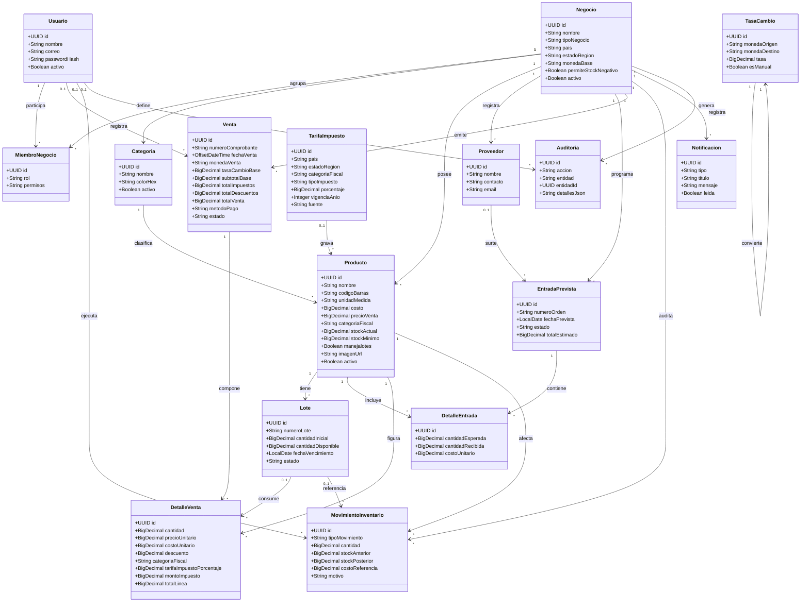

> `manejalotes` se escribe sin tilde en el diagrama para respetar el identificador típico de Java (`manejaLotes`); el nombre real del campo es `manejaLotes`.

## 5. Diagramas de secuencia

### 5.1 Autenticación JWT y renovación

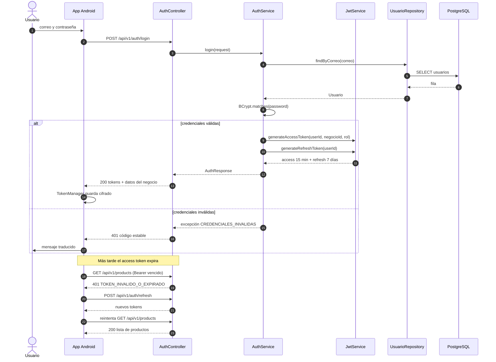

### 5.2 Venta multiproducto con FEFO, impuestos y stock

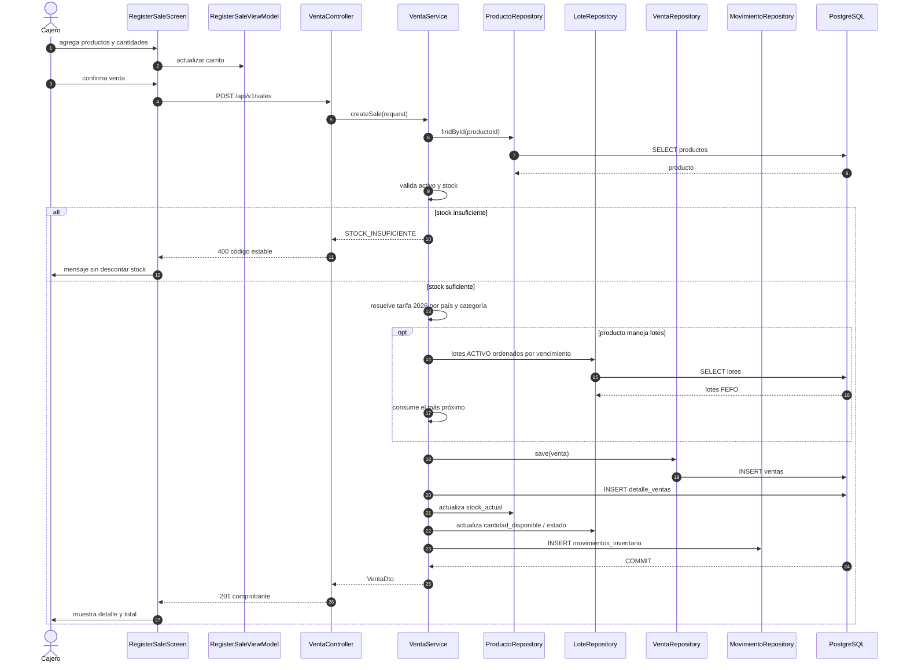

### 5.3 Gestión de producto, lote y vencimiento

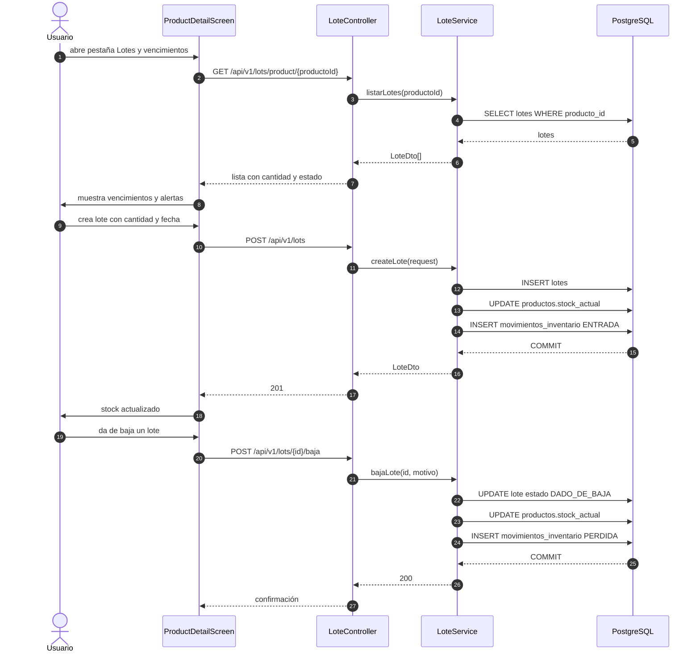

### 5.4 Entrada prevista y recepción

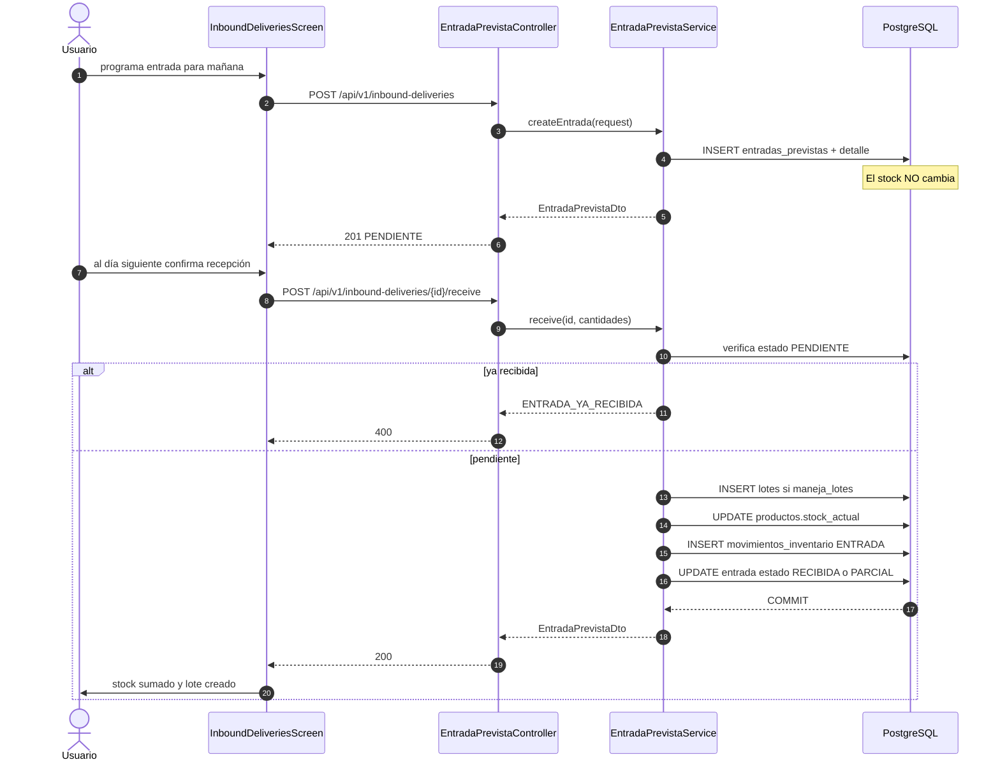

## 6. Metodología Scrum adaptada y flujo Kanban

### 6.1 Ciclo de sprint

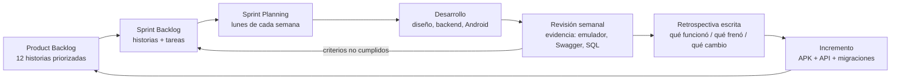

### 6.2 Tablero Kanban

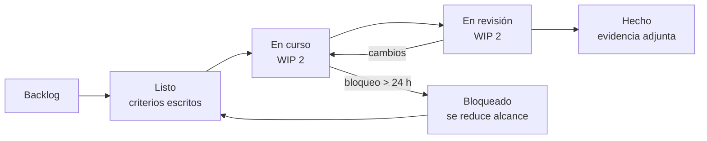

**Reglas del tablero**

1. Ninguna historia entra a *En curso* sin criterios de aceptación.
2. *Hecho* exige evidencia: captura, respuesta HTTP o consulta SQL.
3. WIP máximo de 2 en curso y 2 en revisión.
4. Un bloqueo de más de 24 horas reduce el alcance del sprint; no se acumula deuda invisible.
5. Cada viernes se actualiza el tablero y se escribe la retrospectiva.

### 6.3 Sprints del proyecto

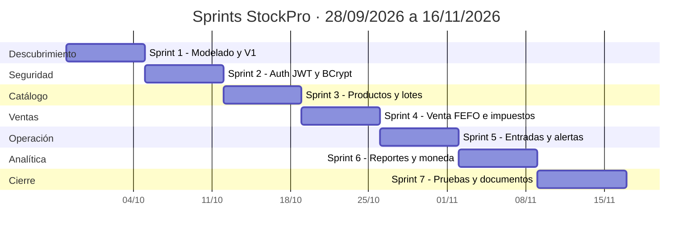

| Sprint | Objetivo | Incremento verificable | Historias |
|---|---|---|---|
| 1 | Descubrimiento y modelo | 16 tablas, V1, necesidad validada | — |
| 2 | Seguridad | Registro, login, refresh, JWT, BCrypt | HU-01, HU-02 |
| 3 | Catálogo | Productos, categorías, lotes, stock | HU-04, HU-05, HU-06 |
| 4 | Ventas | Venta multiproducto, FEFO, impuestos | HU-07 |
| 5 | Operación diaria | Entradas, recepción, movimientos, alertas, tablero | HU-03, HU-08, HU-09, HU-10 |
| 6 | Analítica | Reportes por periodo y moneda, configuración | HU-11, HU-12 |
| 7 | Cierre | Pruebas, datos demo, ABP, landing, PDF | Todas |

### 6.4 Artefactos y Definition of Done

| Artefacto | Contenido real |
|---|---|
| Product Backlog | 12 historias de usuario priorizadas (Must/Should/Could) |
| Sprint Backlog | Tareas técnicas semanales con estimación en puntos |
| Incremento | APK funcional, API ejecutable, migraciones V1–V3, documentación |
| Definition of Done | Compila, corre en emulador, endpoint probado, datos persistidos, errores traducidos, documento actualizado |

## 7. Trazabilidad de diagramas

| Diagrama | Fuente real |
|---|---|
| Arquitectura | `app/`, `backend/`, `docker-compose.yml`, `application.yml` |
| Componentes | `ui/`, `data/`, `controller/`, `service/`, `repository/` |
| Casos de uso | `NavRoutes.kt`, `strings.xml`, controladores y roles |
| Clases | Entidades JPA y migración V1 |
| Secuencia de login | `AuthController`, `AuthService`, `JwtService`, `TokenManager` |
| Secuencia de venta | `VentaService`, `VentaController`, `StockProApi` |
| Secuencia de lotes | `LoteService`, `LoteController`, `ProductDetailScreen` |
| Secuencia de entradas | `EntradaPrevistaService`, `InboundDeliveriesScreen` |
| Scrum/Kanban | Documento maestro ABP, sprints y bitácora del proyecto |
